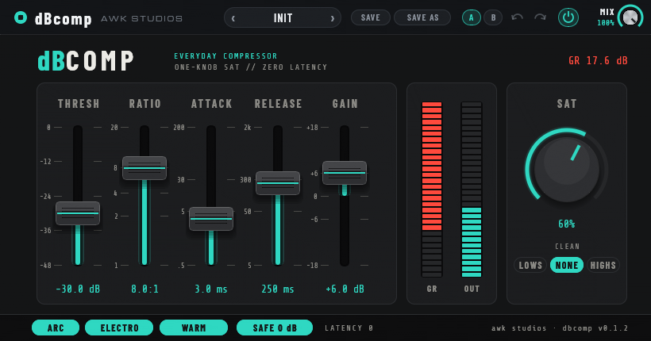

# dBCOMP

**An everyday compressor for inserts (snare, vocals, bass, buses) with a one-knob saturator. Zero latency.**



dBCOMP is the compressor you reach for first: five faders (THRESH, RATIO, ATTACK, RELEASE, GAIN), a big GR meter, and three switches that change how it moves. ARC sets the release from the material so sustained sounds don't pump, ELECTRO / OPTO picks a punchy or a smooth release curve, and WARM adds a little colour as it works. SAT after the compressor adds drive with one knob, and CLEAN can keep the lows or highs out of it.

## Features

- THRESH, RATIO (1:1 to 20:1), ATTACK, RELEASE, GAIN with a 6 dB soft knee.
- **ARC** auto release, **ELECTRO / OPTO** release character, **WARM** colour.
- **SAT** one-knob saturator with CLEAN LOWS / NONE / HIGHS.
- GR and OUT meters, zero latency, almost no CPU.
- 17 factory presets (kick, snare, 808, bass, drums, vocals, buses, sat only).

## Install

Windows 64-bit, VST3. Built and tested in FL Studio.

1. Download `dBcomp-v0.1.2-win64.zip` from [Releases](../../releases/latest).
2. Copy `dBcomp.vst3` into `C:\Program Files\Common Files\VST3\`.
3. Copy the files in `presets` into `Documents\Awknode\Presets\dBcomp\` (create the folder if it doesn't exist).
4. Rescan plugins in your DAW.

## Using it

Every awk studios plugin has the same top strip: preset browser, A/B, undo/redo, power (bypass) and a global MIX. Faders and knobs drag up and down (hold Ctrl or Shift for fine control), scroll to nudge, and double-click to reset. **SAFE** keeps the plugin from going over 0 dBFS; it's on by default.

Every control, with its range and default, is in the **[manual](docs/MANUAL.md)**.

## Build from source

You'll need Docker. Clone this repo next to the [nice-plug-awk](https://github.com/awknode/nice-plug-awk) framework fork, then run the build script:

```sh
git clone https://github.com/awknode/dbcomp
git clone -b awk-studios https://github.com/awknode/nice-plug-awk
cd dbcomp && ./build.sh
```

The plugin lands in `target/bundled/dBcomp.vst3`.

## License

GPL-3.0. See [LICENSE](LICENSE). Built with [nice-plug](https://codeberg.org/RustAudio/nice-plug).

---

More awk studios plugins: [VISE](https://github.com/awknode/vise) · [SALVE](https://github.com/awknode/salve) · [HOIST](https://github.com/awknode/hoist) · [KILN](https://github.com/awknode/kiln) · [PATINA](https://github.com/awknode/patina) · [CHOPSHOP](https://github.com/awknode/chopshop) · [THROWBACK](https://github.com/awknode/throwback) · [THROW FX](https://github.com/awknode/throw-fx) · [KICKNULL](https://github.com/awknode/kicknull) · [ALLEYVERB](https://github.com/awknode/alleyverb) · [WAVETAG](https://github.com/awknode/wavetag) · [dBVOX](https://github.com/awknode/dbvox)
